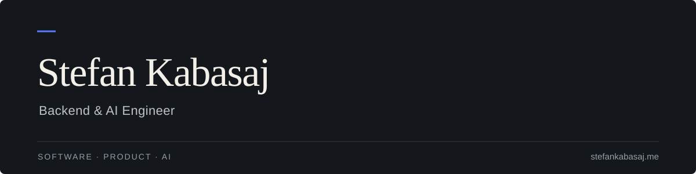

  

  <a href="https://stefankabasaj.me"><strong>Portfolio ↗</strong></a>
  &nbsp;&nbsp; / &nbsp;&nbsp;
  <a href="https://github.com/stefankabasaj?tab=repositories">Repositories</a>

 

I build backend services with **Java and Spring Boot** and work on practical uses of AI.

I enjoy working through how a product should behave, then turning that into clear APIs and code that is easy to maintain.

### Core stack

  

**Java 21 · Spring Boot · PostgreSQL · Docker · REST APIs**  
Also working with Flyway, JWT, React, Postman and IntelliJ IDEA.

### Selected work

<table>
  <tr>
    <td width="50%" valign="top">
      
PERSONAL WEBSITE

      <h3>Portfolio</h3>
      
My work, projects and background in one place.

      
<a href="https://stefankabasaj.me"><strong>Visit website ↗</strong></a> &nbsp; · &nbsp; <a href="https://github.com/stefankabasaj/portfolio">Source</a>

    </td>
    <td width="50%" valign="top">
      
PERSONAL PROJECT

      <h3>Courtly</h3>
      
A tennis booking application, combining software with a sport I know well.

      
Backend &nbsp; / &nbsp; Private source

    </td>
  </tr>
</table>

### Beyond the code

I played NCAA Division I tennis at Sacramento State and now study Business and Information Technology at the University of Memphis.

---

<a href="https://stefankabasaj.me"><strong>stefankabasaj.me ↗</strong></a> &nbsp; More about my work and background.

